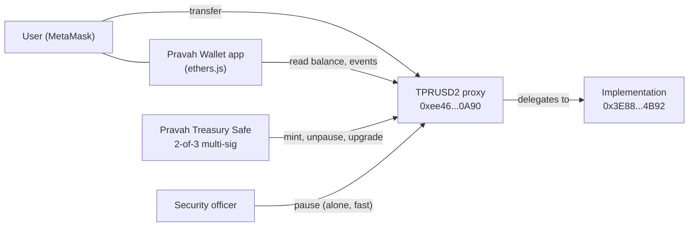

  

<h1 align="center">Pravah Wallet</h1>

  A learning prototype of a <b>US-dollar stablecoin (Pravah USD)</b> for fast, low-cost cross-border payments, with a simple wallet app. 
  <b>Runs only on the Sepolia test network. No real money.</b>

  <a href="https://sepolia.etherscan.io/token/0xee4622696777ab01150106FE37499656c4C20A90">Token on Etherscan</a> ·
  <a href="https://app.safe.global/home?safe=sep:0x0b92Bc21606D12581983C3E3095235eb46500E85">Treasury Safe</a> ·
  <a href="#run-it-locally">Run it locally</a>

---

## The problem

Ramesh works in Dubai and sends money home to his family in India every month. Bank transfers and remittance services charge high fees and can take 1–3 days to arrive.

## The idea

**Pravah USD (PRUSD)** is a stablecoin where **1 PRUSD = 1 US dollar**, backed 1:1 by dollars held in reserve. Sending it takes seconds and costs a fraction of a bank fee. *Pravah* means "flow" in Hindi: money that flows like a river.

This repository is a **testnet prototype** that shows the core technology working end to end.

## What is built

| Part | What it does |
| --- | --- |
| **TPRUSD2 token** | Upgradeable ERC-20 stablecoin contract, 6 decimals (like USDC) |
| **Roles** | Separate keys for admin, minting, upgrading and emergency pause (least privilege) |
| **Emergency pause** | One security officer can stop all transfers instantly during an attack |
| **Multi-sig treasury** | Minting, unpausing and upgrades need **2 of 3** signatures (Safe) |
| **Pravah Wallet app** | Connect MetaMask, see balance and status, send coins, live transaction history, English / Hindi |

## Architecture

## Deployed contracts (Sepolia)

| Contract | Address |
| --- | --- |
| **TPRUSD2 token (proxy, use this)** | [`0xee4622696777ab01150106FE37499656c4C20A90`](https://sepolia.etherscan.io/address/0xee4622696777ab01150106FE37499656c4C20A90) |
| Implementation (logic) | [`0x3E889285f7Bee331A80982eD71a755d5a6584B92`](https://sepolia.etherscan.io/address/0x3E889285f7Bee331A80982eD71a755d5a6584B92) |
| Pravah Treasury (Safe, 2-of-3) | [`0x0b92Bc21606D12581983C3E3095235eb46500E85`](https://sepolia.etherscan.io/address/0x0b92Bc21606D12581983C3E3095235eb46500E85) |
| TPRUSD v1 (first version, no pause) | [`0x8d4075123F015e671CD3931c757cdc5A9fDF3cc9`](https://sepolia.etherscan.io/address/0x8d4075123F015e671CD3931c757cdc5A9fDF3cc9) |

### Who holds which role

| Role | Holder | Why |
| --- | --- | --- |
| `DEFAULT_ADMIN_ROLE` (grant roles, **unpause**) | Treasury Safe | Highest power, needs 2 of 3 signers |
| `MINTER_ROLE` | Treasury Safe | Creating coins must match the reserve |
| `UPGRADER_ROLE` | Treasury Safe | Changing the logic is the most sensitive action |
| `PAUSER_ROLE` | Security officer `0x76f5...5d95` | An emergency stop must be fast, even at 3 a.m. |

One deliberate change from the OpenZeppelin template: `unpause()` requires `DEFAULT_ADMIN_ROLE` instead of `PAUSER_ROLE`. Pausing can be done by one person, but restarting needs the multi-sig, so a stolen pauser key cannot reopen transfers during an attack.

## Tested on Sepolia

- Security officer paused the token alone; transfers failed with `EnforcedPause`.
- A non-admin account tried to unpause and was rejected with `AccessControlUnauthorizedAccount`.
- The Safe ran **unpause + mint 1,000 TPRUSD2** as one atomic batch (via Safe's `MultiSendCallOnly`), signed by 2 of 3 owners.
- First payment sent from the wallet app: [10 TPRUSD2 transfer](https://sepolia.etherscan.io/tx/0xdf8bf9198fc9b4b55d514930bed387bfce74d3aa4011eb9a564daab06e1df0e9).

## Run it locally

MetaMask does not connect to pages opened directly from disk (`file://`), so serve the app from a local server.

1. Install [MetaMask](https://metamask.io) and switch to the **Sepolia** test network. Get free test ETH from a Sepolia faucet.
2. Download `index.html` from this repository.
3. Serve it locally, for example with the VS Code **Live Server** extension (right-click → *Open with Live Server*).
4. Open `http://127.0.0.1:5500/index.html` in the same browser as MetaMask and click **Connect MetaMask**. Use the **हिंदी / English** button at the top to switch the app language.

> **About the GitHub Pages link:** MetaMask may show a phishing warning for this brand-new `github.io` site. That is MetaMask doing its job with new, unknown sites. **Never click "Connect anyway" on a site whose code you have not read yourself.** Running locally avoids this.

## Tech stack

Solidity · OpenZeppelin Contracts (Upgradeable, UUPS, AccessControl, Pausable, Permit) · Remix · Safe{Wallet} · ethers.js v6 · MetaMask · Sepolia testnet · GitHub Pages

## Roadmap

- [ ] Freeze / blacklist role for stolen funds
- [ ] Timelock on upgrades, so changes are public before they apply
- [ ] Automated tests with Foundry
- [ ] Redeem flow: burn on-chain, backend listener triggers the dollar payout
- [ ] Gas-free transfers for users (paymaster / account abstraction)
- [ ] Proof-of-reserve reporting

## Disclaimer

This is a **personal learning project** on a **test network**. TPRUSD has no value and is not a real stablecoin. Issuing a real stablecoin requires licences, a regulated reserve, KYC/AML controls and independent audits. Nothing here is legal or financial advice.

---

Built by [mihit-crypto](https://github.com/mihit-crypto) while learning blockchain development.
